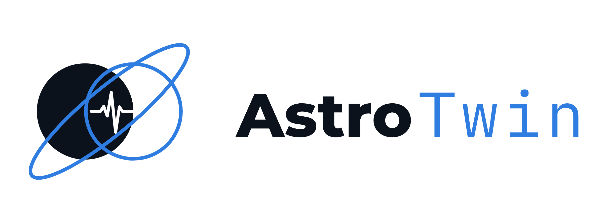

<p align="center"></p>

# AstroTwin — Onboard Astronaut Health Monitor

**NASA Space Apps Challenge 2026** · Challenge: *Create Health Monitoring Software for Astronauts on Space Missions* · Team **TheAstro** (Malatya local event)

AstroTwin is an in-vehicle (offline-capable) health assistant built on NASA's **five hazards of human spaceflight**. It watches both the astronaut's **body and judgment**, and tells the crew what to do **without waiting for Earth**.

> **We did not leave the medical decision to a black box.**
> Scores, alarms and risk tiers are computed by deterministic, rule-based, explainable code. The language model is only a narrator: it re-words findings that were already computed, and it cannot change a single score, threshold or tier. If the model is unreachable the app falls back to template text and keeps working fully offline.

> ⚠️ **All crew data is simulated. AstroTwin is a hackathon prototype, not a medical device, and must not be used for clinical decisions.** Thresholds and adaptation curves are modeled assumptions for demonstration.

**TR özet:** AstroTwin, NASA'nın insanlı uzay uçuşunun 5 tehlikesi üzerine kurulu, araç içinde çevrimdışı çalışan sağlık asistanıdır. Astronotun hem vücudunu hem muhakemesini izler, Dünya'yı beklemeden ne yapılacağını söyler. *Tıbbi kararı kara kutuya bırakmadık:* puanları kural tabanlı kod hesaplar, dil modeli yalnızca anlatır. Mürettebat verisi simüledir; tıbbi cihaz değildir. Arayüz EN/TR.

## What it does

| Idea | Where in the app |
|---|---|
| **5 hazards = 5 panels** (radiation, isolation & confinement, distance from Earth, gravity fields, hostile/closed environment) | Crew |
| **Three-layer normal**: Earth range → personal baseline (flight days 1–14) → expected space-adaptation curve. Alarm when a person leaves *their own* trajectory. "Earth rule would alarm on day X, AstroTwin warned on day Y" | Digital twin |
| **Compound risk engine**: judgment impairment (sleep debt + slow reaction + high CO₂), declared–measured conflict, SEP during EVA, latent virus reactivation, vision change + CO₂ (SANS) | Crew, AI flight surgeon |
| **AI flight surgeon**: every alert says *what happened, why it matters, what to do, NASA source* | AI flight surgeon |
| **Delay awareness**: live Earth–vehicle light time, tiered reporting (Routine / Anomaly / Critical), SBAR reports, a Mission Control screen that receives reports after the delay | SBAR reports, Mission Control |
| **Privacy**: the astronaut chooses whether behavioural detail is shared in non-critical reports; critical thresholds are always shared in full | SBAR reports, Settings |
| **Daily check**: PVT-style reaction test (your own first run is your baseline), mood/stress/sleep/symptoms, Amsler-grid vision self-test | Daily check |
| **Vital signs**: resting HR, HRV, blood pressure, SpO₂, body temperature, fasting glucose, sleep, reaction time, lymphocytes, bone & muscle index — each with a personal baseline and the same deviation rule (temperature, glucose and blood pressure are two-sided) | Crew, Digital twin |
| **Body map**: clickable figure (brain, eyes, heart, lungs, bones & muscles, whole body), coloured by current status, keyboard-operable | Crew |
| **"Why this matters"** cards on every indicator: why we measure it, what can skew it, when to tell the flight surgeon | everywhere an indicator is shown |
| **Crisis mode**: at Critical tier one high-contrast card on top — what happened, 1–3 steps, when the report reaches Earth | every onboard screen |
| **Vision Check** (screening only, not a medical exam): screen calibration with a bank/ID card, tumbling-E acuity per eye on a logMAR scale (20/x and 6/x), Amsler grid per eye with tap-to-mark, a 2-question eye questionnaire. First calibrated result is the per-eye baseline; ≥0.2 logMAR drop → Watch, ≥0.3 or a new Amsler change → tell the flight surgeon today, pain/flashes/floaters/curtain → Critical (auto report). Full acuity weekly or on an eye symptom; daily in demo mode | Daily check, Settings |
| **Guided tour and Help**: a step-by-step tour that dims the screen and lights one section at a time (auto-starts on first visit), and a Help page with screens, glossary, FAQ and keyboard shortcuts | everywhere, Help |
| **Check-in streak** and three gentle badges (7-day streak, Full check, Vision check); no points, no rankings | Daily check |
| **Demo scenarios**: Nominal cruise, **Hidden decline** (opening scenario), Solar storm (real GLE74 event, 11 May 2024), Immune watch | scenario menu on Crew |

## Run it

Requires Node.js 22+.

```bash
npm install
cp .env.example .env      # optional — the app runs without any keys
npm run dev               # http://localhost:3000  (web app + /api proxy on one port)
npm test                  # engine + API-guard unit tests
npm run build && npm start  # production: Express serves ./dist and /api
```

### Environment variables (`.env`, server-side only)

| Variable | Purpose | Default |
|---|---|---|
| `NASA_API_KEY` | api.nasa.gov key for DONKI | `DEMO_KEY` (rate-limited) |
| `GEMINI_API_KEY` | Google AI Studio key for the narrator. Optional | – (template text is used) |
| `GEMINI_MODEL` | Gemini Flash model id | `gemini-flash-latest` |
| `PORT` | Server port | `3000` |

No key is ever sent to the browser: the client only calls `/api/*` on this app.

## Architecture

```
┌──────────────────────────── browser (works offline, PWA shell) ───────────────────────────┐
│  UI (React, existing design)   src/components/…                                           │
│        │                                                                                  │
│  state/mission.tsx ── wires data into ──▶ src/engine/   PURE, deterministic, unit-tested  │
│        │                                   model.ts     metrics, dose models, scenarios   │
│        │                                   baseline.ts  three-layer normal, alarm days    │
│        │                                   rules.ts     5 compound risk rules             │
│        │                                   scoring.ts   assess(): scores, findings, tier  │
│        │                                   sbar.ts      privacy filter + SBAR template    │
│        │                                   radiation.ts GLE74 replay, S1 threshold        │
│        │                                   delay.ts     light time, offline Mars range    │
│  src/services/  donki · swpc · horizons · gemini                                          │
│        each: live → last cached copy → embedded data   (badge: Live / Cached / Embedded)  │
└────────┬──────────────────────────────────────────────────────────────────────────────────┘
         │ /api/*   (timeouts + cache, keys stay here)
┌────────▼─────────────── server.ts + server/handlers.ts (Express) ─────────────────────────┐
│ /api/donki    → api.nasa.gov DONKI (SEP, FLR, CME, notifications)                         │
│ /api/swpc     → NOAA SWPC GOES integral proton flux                                       │
│ /api/horizons → JPL Horizons, Earth–Mars range (cached daily)                             │
│ /api/narrate  → Gemini: findings in → {situation, background, assessment,                 │
│                 recommendation, crewMessage} out, schema-checked, numbers verified        │
└───────────────────────────────────────────────────────────────────────────────────────────┘
```

### The LLM guardrails

1. `assess()` computes everything. The narrator receives only its output (`buildPayload`).
2. Privacy is applied **before** the payload is built: if the astronaut turned behavioural sharing off and the tier is not critical, that data is not sent to the model either.
3. The system instruction: use only the given findings, invent no diagnosis, change no number, frame advice as an *onboard protocol recommendation*, be brief.
4. Output must match the JSON schema, and **every number in the narrated text must already exist in the input** (`numbersAreGrounded`). Checked on the server and again in the browser.
5. Any failure (no key, timeout, bad JSON, changed number) → deterministic template (`templateSbar`). The UI shows which one you are reading.

### Offline behaviour

| Data | Live source | Fallback |
|---|---|---|
| Space-weather events | NASA DONKI | last cached copy → embedded GLE74 timeline |
| Proton flux | NOAA SWPC GOES (`/json/goes/primary/integral-protons-6-hour.json`) | cached copy → quiet-Sun background. Only a **live** reading can raise the "SEP active" flag |
| Earth–Mars range | JPL Horizons | cached copy → embedded Keplerian model (within 1% of Horizons, unit-tested) |
| Narration | Gemini Flash | template SBAR |

A service worker (`public/sw.js`) caches the app shell in production builds.

## Design → function mapping

The visual design (colours, typography, layout, components) is the original dashboard design and was kept; only data and behaviour were connected.

| Design screen | AstroTwin function |
|---|---|
| Dashboard | Crew: tier + readiness ring, crew cards, 5 hazard panels, compound risks, vitals, onboard protocol |
| Sleep | Daily check: PVT, self-report, Amsler grid |
| Trends | Digital twin: three-layer normal chart, Earth rule vs AstroTwin counters |
| Predictions | AI flight surgeon |
| Activity | Radiation: dose budget, GOES proton flux, DONKI events, GLE74 replay |
| Reports | SBAR reports, tiers, privacy |
| Notifications | Mission Control (delayed inbox) |
| Settings | Language, mission profile, privacy, appearance, sources |

## Deploy

**Vercel** (simplest, free tier):

1. Import the GitHub repository at vercel.com → *Add New… → Project*. The Vite preset, build command and output folder are read from `vercel.json`.
2. Under *Settings → Environment Variables* add `NASA_API_KEY`, `GEMINI_API_KEY` and optionally `GEMINI_MODEL` / `GEMINI_FALLBACK_MODEL`, then redeploy.
3. Custom domain: *Settings → Domains → Add*, then create the DNS record Vercel shows at your registrar (an `A` record for the apex domain or a `CNAME` to `cname.vercel-dns.com` for a subdomain). TLS is issued automatically.

On Vercel the API runs as one serverless function, `api/[route].js`. It is a committed bundle of `server/vercel.ts` + `server/handlers.ts`; after changing anything under `server/` or `src/engine/sbar.ts`, run `npm run build:api` and commit the result.

The app is also one small Node server (API proxy + static files), so any Node/Docker host works.

**Google Cloud Run** (uses the Space Apps Global Offer credit):

```bash
gcloud run deploy astrotwin --source . --region europe-west1 --allow-unauthenticated --set-env-vars NASA_API_KEY=YOUR_KEY,GEMINI_API_KEY=YOUR_KEY
```

The included `Dockerfile` is picked up automatically. For production, prefer `--set-secrets` with Secret Manager over plain env vars.

**Custom domain** (the domain from the Global Offer):

1. Verify the domain: `gcloud domains verify YOUR_DOMAIN`
2. Map it: `gcloud beta run domain-mappings create --service astrotwin --domain app.YOUR_DOMAIN --region europe-west1`
3. Add the DNS records that the command prints (a `CNAME` to `ghs.googlehosted.com` for a subdomain) at your registrar. The TLS certificate is issued automatically, usually within an hour.

**Any other host** (Render, Railway, Fly.io…): build command `npm install && npm run build`, start command `npm start`, set the environment variables above.

## Sources

- NASA HRP — 5 Hazards of Human Spaceflight: https://www.nasa.gov/hrp/hazards/
- NASA HRP — Risks of Human Spaceflight: https://www.nasa.gov/hrp/risks/
- NASA HRP — Ongoing Research: https://www.nasa.gov/hrp/ongoing-hrp-research/
- CSA — Monitoring Radiation for Astronaut Health (neutrons ≈ 30% of ISS radiation exposure): https://www.asc-csa.gc.ca/eng/news/articles/2026/2026-02-26-monitoring-radiation-astronaut-health.asp
- NASA DONKI: https://kauai.ccmc.gsfc.nasa.gov/DONKI/
- NOAA SWPC GOES proton flux: https://www.swpc.noaa.gov/products/goes-proton-flux
- JPL Horizons API: https://ssd.jpl.nasa.gov/api/horizons.api
- Dose models: Curiosity RAD cruise ≈ 1.84 mSv/day; Chang'e-4 LND lunar surface ≈ 1.37 mSv/day; NASA-STD-3001 career limit 600 mSv

## Decisions and known limits

- **Engine was rebuilt from the written spec.** The single-file prototype (`astrotwin-referans.html`) was not in the repo when this was built, so weights and thresholds in `src/engine/model.ts` and `rules.ts` are reasonable choices, not a port. They live in one place and are easy to reconcile.
- **Modeled assumptions:** adaptation curves, the cabin CO₂ threshold (3.0 mmHg), the LEO dose rate (0.6 mSv/day) and the extra SEP dose during EVA are illustrative, not NASA flight rules.
- **GLE74 replay:** the embedded timeline uses the times from the project brief (X5.8 peak 01:32 UT, >100 MeV rise 01:45 UT, peak 02:45 UT); the curve shape is schematic. DONKI lists the >100 MeV SEP at 02:10 UT. GOES does not serve 2024 flux history from the live endpoint, so the replay curve is not measured data.
- **PVT:** a 5-trial browser test is a demonstration, not a validated PVT-B. The user's change against their own baseline is mapped onto the selected crew member.
- **Deploy:** the Dockerfile / Cloud Run path was written but not deployed from this machine.
- AI assistance: built with Claude Code (Anthropic); narration by Google Gemini when configured.
